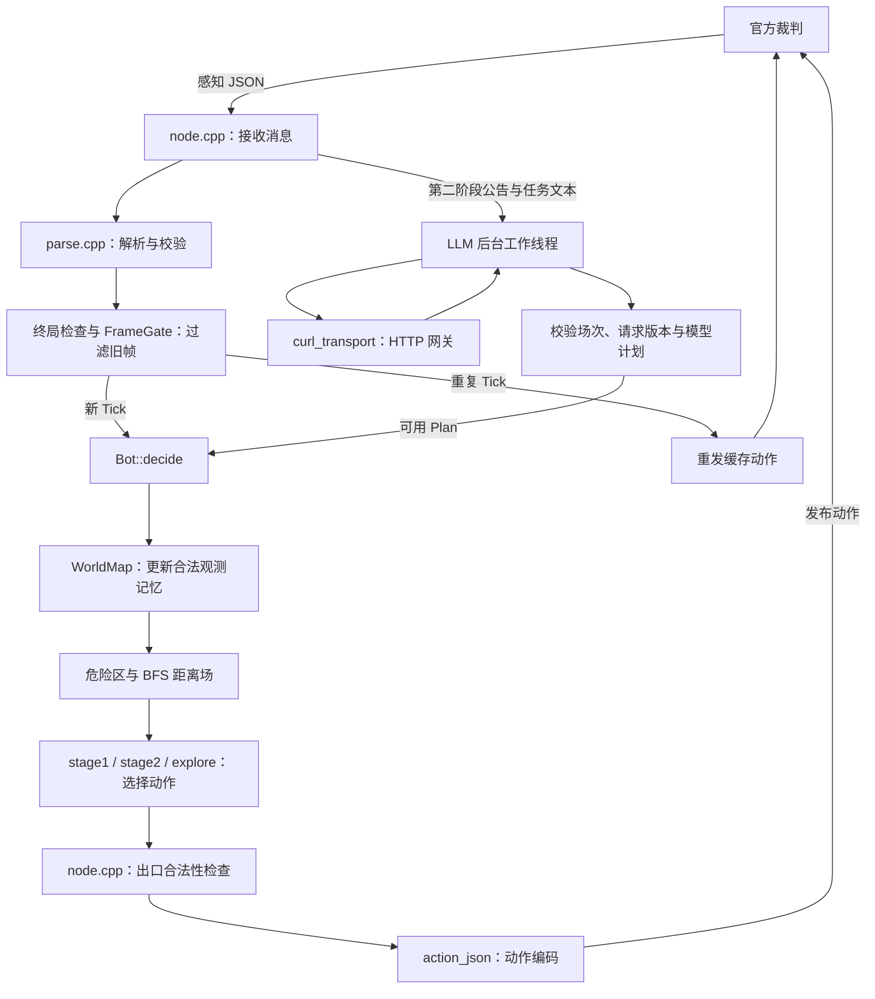

# 当前项目目录与运行流程（中文导览）

本文对应校内 3.0 加本次底层修复后的结构。先记住：**当前比赛程序的源码在 `versions/v3/`；根目录的 `rmtc_ws/` 与 `decision/` 是保留的旧版。** 两套程序分别编译，不能把旧版编译通过当成新版已编译。

3.0 仍沿用 `rmtc2` 命名空间、`rmtc_bot2` ROS 包名和可执行文件名。这是兼容原有接入命名，不表示启动了旧版。目录名、包名和版本号是三个不同概念。

## 1. 整个仓库的结构

标注“生成”的目录只在本机编译或测试后出现，不属于要手工维护的源码。树中展开关键文件，官方 PDF 和历史材料作合并展示。

```text
ZKXWN/                                  ← Git 仓库根目录
├── README.md                           ← 总入口；优先阅读当前 3.0 链接
├── versions/
│   └── v3/                             ← 【当前主版本】源码、构建脚本、资料
│       └── …                           ← 下一节完整展开
├── docs/                               ← 仓库级说明、旧版交接和历史测试报告
│   ├── PROJECT_STRUCTURE.md            ← 本文：目录导航和各模块用途
│   ├── ARCHITECTURE.md                  ← 旧版架构；不要照搬成 v3 的文件位置
│   ├── FOUNDATION.md                   ← 旧版底层实现与测试说明
│   ├── TEAM.md / HANDOVER.md            ← 旧版分工和交接参考
│   ├── STRATEGY_HANDOVER.md             ← 旧版决策/战斗/LLM 交接参考
│   ├── STRATEGY_OPTIMIZATION_PLAN.md    ← 策略改进思路，不是全部已实现功能
│   ├── RULES_V1_1.md                    ← v1.1 适配说明
│   ├── RULES_V1.1_DELTA.md              ← 规则变化说明
│   ├── TECH_REPORT_TEMPLATE.md          ← 技术报告模板
│   ├── MULTIMAP.md                     ← 旧版多地图验证说明
│   └── COLLECTION_OPTIMIZATION.md      ← 旧版采集优化实验及局限
├── rmtc_ws/                            ← 【旧版】ROS 工作空间
│   ├── src/rmtc_bot/                   ← 旧版节点、地图、策略与测试源码
│   └── build/ install/ log/            ← 旧版构建结果（生成）
├── decision/                           ← 【旧版】可独立编译的决策库
│   ├── include/rmtc_decision/          ← 对外类型、决策接口、战斗计算
│   ├── src/engine.cpp                  ← 旧版决策引擎实现
│   ├── tests/scenarios.cpp             ← 决策场景回归
│   └── examples/                      ← 使用示例和规划器示例
├── scripts/                            ← 旧版脚本及仓库共享测试工具
│   ├── build.sh / run.sh / test.sh      ← 操作【旧版】rmtc_bot
│   ├── test_offline.sh                 ← 旧版不依赖 ROS 的构建与测试
│   ├── test_ros_io.py                  ← 旧版 ROS 消息收发回归
│   ├── test_multimap_referee.py         ← 官方练习裁判多地图驱动；可指定新版程序
│   ├── generate_multimap.py            ← 根据种子生成测试地图
│   └── report_*.py                     ← 从测试数据生成报告，不参与比赛决策
├── third_party/                        ← 旧版使用的随仓库第三方依赖
├── build/                              ← 仓库级测试产物（生成）
│   └── sync-validation/                ← 本次同步、修复前后日志及裁判记录
├── .env.example                        ← 旧版环境配置示例；不是新版唯一配置入口
├── README_RMTC_CPP.md                   ← 原框架说明，作为历史参考
├── RMTC_CPP_集成说明.md                  ← 原框架集成材料，路径以当前源码为准
├── .gitignore                          ← 指定不提交的构建产物等文件
├── .git/                               ← Git 自己保存提交和分支信息的目录
└── .vscode/                            ← 本机编辑器设置，本次不提交
```

旧版仍有价值：用于对照策略、复用地图测试、比较成绩。但它不是 v3 主程序运行时加载的决策库。一个例外是 v3 的 `bench.sh`，为做新旧对抗，会专门编译并连接旧版代码。

## 2. 当前版本 `versions/v3/` 的详细结构

```text
versions/v3/
├── README.md                           ← 新版编译、启动、环境配置及验证边界
├── CMakeLists.txt                      ← 核心与模拟 LLM 测试的构建入口；不要求 ROS
├── 更新日志.md                          ← 发布 3.0 时记录的改动与原因
├── 文件清单.json                        ← 原交付包文件清单；不是构建配置或动态目录索引
├── src/
│   └── rmtc2/                          ← 【C++ 核心】感知、地图、路线、两阶段决策
│       ├── types.hpp                   ← 公共数据类型定义
│       ├── types.cpp                   ← 类型相关辅助实现
│       ├── parse.hpp                   ← 感知解析、动作编码、模型计划解析接口
│       ├── parse.cpp                   ← JSON 到 C++ 数据的转换和字段校验
│       ├── frame_gate.hpp              ← 场次与 Tick 顺序过滤器，实现在头文件中
│       ├── grid.hpp                    ← 地图记忆、危险区、BFS、采集路线接口
│       ├── grid.cpp                    ← 上述地图和路径算法的实现
│       ├── combat.hpp                  ← 战斗得分和伤害分摊计算，实现在头文件中
│       ├── bot.hpp                     ← Bot 决策器接口、状态和缓存声明
│       └── bot.cpp                     ← 第一阶段、第二阶段、探索等决策实现
├── ros2_ws/                            ← 【ROS 工作空间】把核心接到裁判通信上
│   ├── src/
│   │   └── rmtc_bot2/                  ← 当前 ROS 包，名称仍保留 bot2
│   │       ├── package.xml             ← ROS 包名、版本及依赖声明
│   │       ├── CMakeLists.txt          ← 构建节点并连接核心、ROS、curl 等依赖
│   │       ├── config/
│   │       │   └── decision_config.json ← 决策档位：balanced / collect / fight
│   │       ├── include/rmtc_bot2/
│   │       │   ├── node.hpp            ← ROS 节点创建接口
│   │       │   └── llm.hpp             ← LLM 后台线程、结果及 HTTP 传输接口
│   │       └── src/
│   │           ├── main.cpp           ← 程序入口，初始化 ROS 并运行节点
│   │           ├── node.cpp           ← 参数、订阅、发布、换场次、动作缓存、模型调度
│   │           ├── llm.cpp            ← LLM 请求工作线程、重试、结果交接
│   │           └── curl_transport.cpp ← 使用 libcurl 发送 HTTP 请求
│   ├── build/                         ← 编译中间文件（生成）
│   ├── install/                       ← 编译后可运行程序、环境脚本等（生成）
│   └── log/                           ← colcon 构建日志（生成）
├── scripts/
│   ├── test.sh                        ← 编译并运行核心和模拟 LLM 线程回归
│   ├── build.sh                       ← 加载 ROS Humble 并编译 rmtc_bot2
│   ├── run.sh                         ← 设置配置文件路径，启动指定席位和阶段
│   ├── test_ros_io.py                 ← 本次新增：新版 ROS 消息回归
│   └── bench.sh                       ← 编译自研模拟裁判、新旧策略，进行对抗比较
├── tests/
│   ├── core_tests.cpp                 ← 协议、路线、战斗、场次和探索等核心回归
│   └── llm_worker_tests.cpp            ← 用模拟 HTTP 传输检查真实工作线程生命周期
├── tools/
│   └── bench/                         ← 【仅测试】自研对抗基准，不是官方裁判
│       ├── bench_main.cpp             ← 多地图、换席位、成绩和耗时统计入口
│       ├── referee.hpp / referee.cpp  ← 模拟地图和比赛结算逻辑
│       └── legacy_adapter.hpp/.cpp    ← 把旧版策略接入同一模拟测试接口
├── third_party/
│   └── nlohmann/                      ← 随仓库提供的 C++ JSON 解析库和许可证
├── evidence/                          ← 可查看的测试证据与本次复测说明
│   ├── 3.0_回归输出.txt                ← 原发布时的历史回归输出
│   ├── bench_raw.txt                  ← 历史模拟基准输出，成绩需看对应版本
│   ├── ubuntu-foundation-fixes.md      ← 本次 Ubuntu 底层修复、测试结果和复现命令
│   └── …                              ← 原交付文件变化记录等
├── 02_官方规则_v1.1_当前/               ← 官方规则、通信协议、测试教程 PDF
├── 03_官方练习包_v1.1/
│   └── dist.zip                       ← 官方练习裁判压缩包，测试前需要解压
├── 历史说明_2.0原文/                   ← 原 2.0 设计、验收材料；保留来源和背景
├── build_core/                        ← 核心库和测试可执行文件（生成）
└── build_bench/                       ← 自研模拟对抗可执行文件（生成）
```

`文件清单.json` 和历史 `evidence` 文件反映当时的交付状态，不会随每次改动自动更新。本次修改以 Git 差异和 `ubuntu-foundation-fixes.md` 为准。

## 3. 几个核心文件到底做什么

| 文件/模块 | 输入与输出 | 用途及修改时机 |
|---|---|---|
| `types.hpp` | 定义 `Perception`、`Action`、`Plan` 等结构 | 所有模块使用的共同“表格格式”。新增一个跨模块字段，先看这里。 |
| `parse.cpp` | 输入裁判 JSON，输出 `Perception`；输入动作，输出协议 JSON | 校验 Tick、场次、位置和视野等字段，解析实体相对坐标。模型返回内容也在这里整理为经过结构校验的 `Plan`。通信字段不对、JSON 解析失败时先查这里。 |
| `frame_gate.hpp` | 输入场次 ID 和 Tick，输出拒收/新场次/新 Tick/重复帧 | 防止迟到的旧场次帧把当前比赛重置，拒绝同场次旧 Tick。重复帧由节点重发缓存动作，不重新推进策略。 |
| `grid.cpp` 的 `WorldMap` | 输入每一帧合法感知，更新已知空地、障碍和资源 | 记住已看到的信息；不直接读取官方裁判的完整地图。本次零视野修复在这里增加未知边界目标。 |
| `grid.cpp` 的 `HazardField` | 输入模型计划中的危险区域及时间窗 | 查询某格某 Tick 是否危险/禁行。它使用已解析的计划，不直接用关键词解释自然语言公告。 |
| `grid.cpp` 的 `BlockMask`、`bfs`、`Field` | 输入不可通行格、当前位置和剩余步数；输出各格距离与第一步方向 | 用一次 BFS 支持多个目标查询，避免每个候选都从头找路。它计算路线，目标取舍由 `Bot` 做。 |
| `grid.cpp` 的 `solve_tour` | 输入资源间距离、价值和步数预算，输出访问顺序 | 第一阶段采集路线规划。目标数不超过 13 时用精确 DP；更多时用贪心，不应解释为所有地图全局最优。 |
| `bot.cpp` | 输入感知、地图记忆和可用计划；输出动作、原因和估值 | `prepare()` 更新地图与距离场；`stage1()` 选择采集路线；`stage2()` 比较采集、任务、战斗等候选；`explore()` 处理没有明确目标时的探索。 |
| `combat.hpp` | 输入伤害贡献、生命值等预测数据，输出伤害/击杀分摊及得分估计 | 把 v1.1 的战斗计分用于决策估值。最终实际得分由官方裁判结算。 |
| `node.cpp` | 输入 ROS 话题消息，调用核心并发布动作 | 将上面各模块串起来，负责参数、席位、终局停止发送、重复动作缓存、注册、场次清理、模型请求与计划应用。事件请求内容与解析要求也在这里组织。 |
| `llm.cpp` | 输入模型请求及场次信息，异步返回 HTTP/模型结果 | 在后台线程执行慢请求，主动作回调不等待模型。处理停止、重试、结果过期和场次隔离。 |
| `curl_transport.cpp` | 输入地址、令牌、请求体，输出响应和 HTTP 状态 | 真正的网络传输层，处理超时、取消和响应体大小限制；不负责决定机器人往哪走。 |

`.hpp` 通常声明“有哪些类型和函数”，`.cpp` 通常实现“这些函数怎样工作”。`combat.hpp` 和 `frame_gate.hpp` 是小模块，直接在头文件内实现，所以没有对应的 `.cpp`。

## 4. 程序运行时的数据流



例如裁判通知“第 12 Tick，你在 `[3, 2]`，附近有一个资源”：`node.cpp` 接收消息，`parse.cpp` 将 JSON 转成结构体，`FrameGate` 确认不是过期帧，地图记录资源，BFS 得到路线，`Bot` 选择动作，节点最终发送带正确 `tick` 和 `session_id` 的动作 JSON。下一帧的实际位置和得分用于更新状态。

模型是第二阶段的异步辅助路径，不是每个 Tick 都必须等待的入口。没有本场网关配置或没有可用新计划时仍有本地决策；这不代表通过正式 AI 资格验收。

## 5. 裁判通信从哪里看

以下以 A 席位为例；B/C/D 的 `/team_A` 前缀相应替换。

| 话题 | 机器人方向 | 作用 |
|---|---|---|
| `/team_A/perception` | 接收 | 本队感知，包含 Tick、场次、位置、实体、得分等。上一动作回执通过感知中的 `self.last_action` 提供；不是另建一个回执话题。 |
| `/team_A/action` | 发送 | 当前动作 JSON。重复 Tick 可以重发同一缓存动作，结束帧不发新动作。 |
| `/team_A/registration` | 发送 | 报告席位与队名，由节点周期发布。 |
| `/referee/event_text` | 接收 | 自然语言事件公告；请求模型时优先使用感知携带的非空公告文本。 |
| `/referee/mission` | 接收 | 任务文本，供模型请求等处理使用。 |

话题名、QoS、回调以及发布行为主要看 `ros2_ws/src/rmtc_bot2/src/node.cpp`。

## 6. 你和队友分别从哪里改

这是一份导航建议，实际交叉修改仍需双方协调，尤其是共同使用的 `bot.cpp` 和 `node.cpp`。

| 想做的事情 | 当前版主要位置 | 建议验证 |
|---|---|---|
| 通信字段、感知合法性 | `parse.cpp`、`types.hpp`、`node.cpp` | 核心解析测试 + `scripts/test_ros_io.py` |
| 地图记忆、BFS、零视野探索 | `grid.cpp/.hpp`、`bot.cpp` 的 `explore()` | 核心地图测试 + 官方多地图 |
| 第一阶段采集、路线预算 | `bot.cpp` 的 `stage1()`、`solve_tour()` | 核心路线测试 + 真实裁判采集成绩 |
| 场次切换、重复帧、比赛结束 | `frame_gate.hpp`、`node.cpp` | 核心场次测试 + ROS 收发测试 |
| 第二阶段战斗及目标权重 | `bot.cpp` 的 `stage2()`、`combat.hpp` | 战斗回归 + 模拟对抗 + 官方第二阶段验收 |
| LLM 提示内容、请求条件 | `node.cpp` 的 `maybe_request_llm()` | 计划解析测试、网关联调 |
| LLM 线程、HTTP、重试 | `llm.cpp`、`llm.hpp`、`curl_transport.cpp` | 模拟线程回归 + 真实 HTTP 联调 |
| 编译和启动 | v3 的 `scripts/`、两处 `CMakeLists.txt`、`package.xml` | 核心构建和 ROS 全包构建 |

你负责的前半段主要集中在 `parse`、`grid`、`frame_gate`、ROS 接入与 `Bot::stage1/explore`。队友的后半段主要集中在 `Bot::stage2`、`combat` 与 LLM。v3 并没有像旧版那样单独拆出 `stage1_policy.cpp`，不要找错目录。

## 7. 构建与测试入口，不要混淆

以下命令均从 `ZKXWN/` 仓库根目录执行。

```bash
# 1. 不依赖 ROS：编译核心并运行核心/模拟 LLM 线程测试
bash versions/v3/scripts/test.sh

# 2. 编译实际要运行的新版 ROS 节点
bash versions/v3/scripts/build.sh

# 3. 启动新版 A 席位第一阶段；第二阶段将最后的 1 改为 2
# ROS_DOMAIN_ID 需事先设置为裁判实际使用的域
bash versions/v3/scripts/run.sh A 1
```

`run.sh` 只启动机器人，不启动裁判。成功运行核心测试也不会生成 ROS 的 `install/`，所以首次运行节点前仍要执行 `build.sh`。

| 测试 | 能验证什么 | 不能据此宣称什么 |
|---|---|---|
| `versions/v3/scripts/test.sh` | 纯 C++ 核心和模拟传输的 LLM 线程 | 真实裁判接入或真实模型调用成功 |
| `versions/v3/scripts/test_ros_io.py` | 真实 ROS 节点对人工构造消息的收发 | 官方整场成绩、所有异常场景都已覆盖 |
| 根目录 `scripts/test_multimap_referee.py --bot-executable …` | 指定机器人在官方练习裁判中的第一阶段多地图运行 | 第二阶段完整验收或正式比赛胜率 |
| `versions/v3/scripts/bench.sh` | 自研模拟环境下新旧策略同图比较 | 官方裁判完整规则覆盖或正式 AI 资格 |

新版 ROS 测试目前复用根目录旧版 `rmtc_ws/.../test/fixtures/` 的协议样例；官方多地图驱动也默认读取那里的 `stage1_suite.json`。因此复制 `versions/v3` 单目录到其他机器时，核心构建和节点可以独立使用，但这些跨目录集成测试应保留完整仓库。

## 8. 目录名和缩写速查

| 名称 | 含义 | 在本项目里的角色 |
|---|---|---|
| `src` | source，源码 | 写 C++ 实现的地方 |
| `include` | 头文件目录 | 供其他代码使用的接口声明 |
| `config` | configuration，配置 | 决策档位等运行配置 |
| `scripts` | 脚本 | 自动执行构建、启动或测试命令 |
| `tests` / `test` | 测试 | 回归代码、场景和样例 |
| `fixtures` | 固定测试样例 | 提供可重复的协议输入 |
| `tools` | 工具 | 模拟裁判、统计等辅助程序 |
| `bench` | benchmark，基准测试 | 比较策略成绩与计算开销 |
| `evidence` | 验证证据 | 保存报告或测试输出 |
| `third_party` | 第三方依赖 | 已有库，例如 nlohmann JSON |
| `ws` | workspace，工作空间 | ROS 构建和安装组织单位 |
| `BFS` | 广度优先搜索 | 在网格中计算最短步数与第一步 |
| `DP` | 动态规划 | 在资源目标较少时求采集访问顺序 |
| `LLM` | 大语言模型 | 将公告文本整理为事件计划 |
| `Tick` | 裁判离散时间步 | 每一轮动作及其结算的编号 |
| `session_id` | 场次标识 | 区分不同比赛，防止旧数据串场 |

日常修改源码，不直接编辑 `build/`、`install/` 中的产物；修改后重新编译。模型网关和令牌通过环境变量配置，真实令牌不要写进提交文件。完整修复结果和当前验证范围见 [Ubuntu 底层修复回归](../versions/v3/evidence/ubuntu-foundation-fixes.md)。
